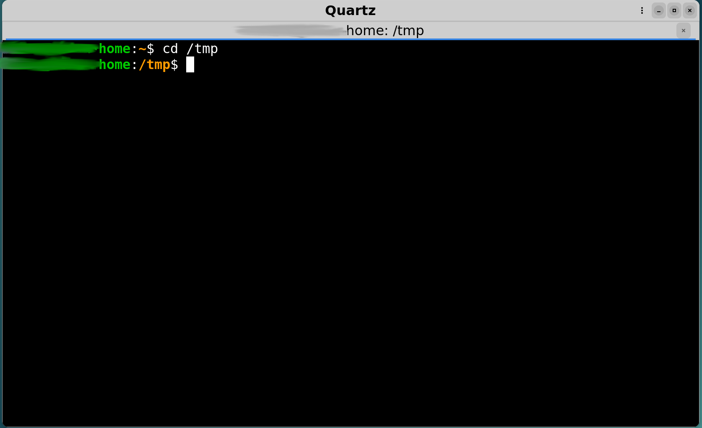

# Quartz

Terminal emulator

Requires:
- python3
- Gtk4
- the command ps

Note: the file com.quartz.terminal.emulator.png in icons must be copied in /usr/share/icons/hicolor/48x48/apps/ .

Features:
- the most common for a terminal emulator
- command line options: -e for executing a terminal program; -w for passing a target folder
- graphical dialog settings

